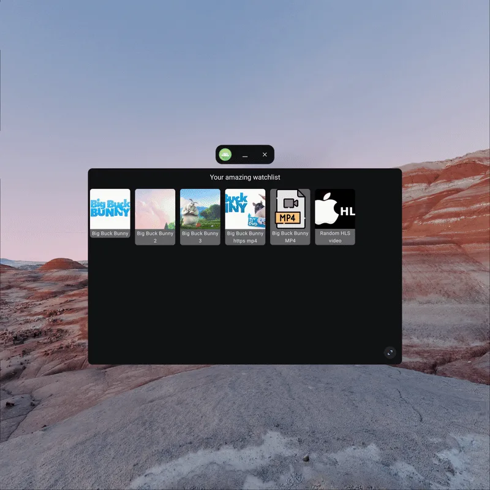
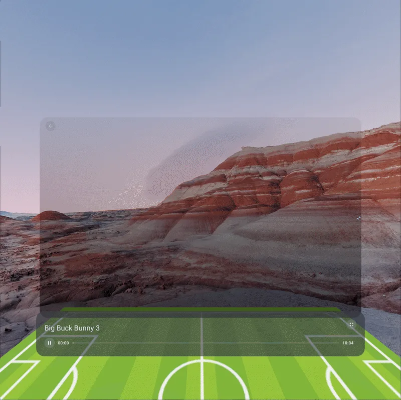
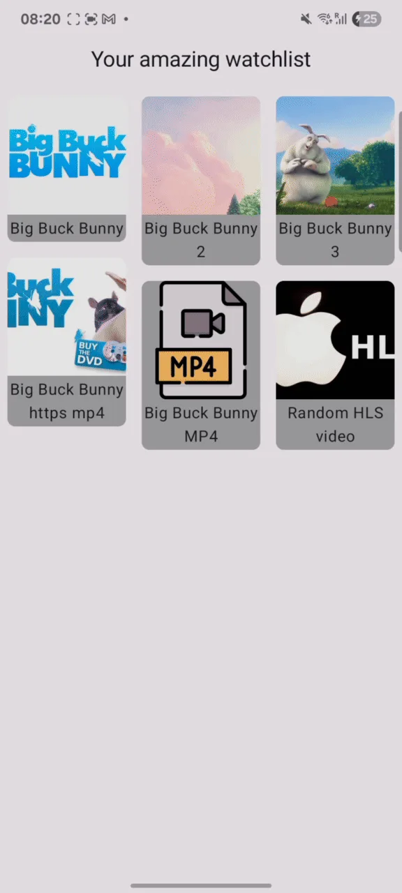

# GoudurixXR: Immersive Video Player for Android XR

An Android XR sample that plays video in a spatial panel, built on **Jetpack Media3 (ExoPlayer)**, with a **GLTF**
football field rendered in the scene through **androidx.xr.scenecore**.

[](https://www.android.com)
[](https://developer.android.com/jetpack/compose)
[](https://kotlinlang.org)



| XR video player with the 3D field | Phone watchlist |
|:---:|:---:|
|  |  |

Motion demos: [XR emulator (GIF, 42 MB)](doc/demoXr.gif) and [phone (GIF)](doc/demoPhone.gif).

---

## Features

- **Video playback with Media3:** ExoPlayer runs inside a `MediaSessionService`, with 10-second seek steps, repeat-all
  and scale-to-fit video.
- **HLS and MP4:** HLS streams via `media3-exoplayer-hls`, plus a bundled local MP4 for offline playback.
- **Spatial UI on XR:** the player uses `SpatialPanel` and `SpatialColumn` when spatial UI is enabled, and falls back to
  a flat layout otherwise.
- **GLTF in the scene:** a football field `.glb` is loaded once with `GltfModel` and cached for reuse.
- **Video list from a remote API:** channel logos come from the iptv-org API, alongside hard-coded sample videos.
- **Dependency injection:** Hilt, with ViewModels driving the Compose screens.

## Tech stack

Kotlin, Jetpack Compose and Compose Material 3, Android XR (`xr.runtime`, `xr.scenecore`, `xr.compose`, `xr.arcore`),
Media3 (exoplayer, session, ui-compose, HLS), Hilt with KSP, Ktor client with kotlinx.serialization, Coil, Kotlin
Coroutines and Flow, Material 3 Adaptive.

## Architecture

```
ui/            Compose screens (video list, player, football field), ViewModels, components
data/          VideoRepository (Flow) -> VideoService (Ktor, iptv-org API), entities
PlaybackService  MediaSessionService that owns the ExoPlayer instance
FootballFieldGltfModelCache  loads and caches the GLTF model for the XR scene
```

## Getting started

Requirements: Android Studio with an Android XR emulator (or an XR device), minSdk 34, targetSdk 36.

1. Clone the repository and open it in Android Studio.
2. Let Gradle sync, then run the `app` configuration on an Android XR emulator.
3. Internet is required for the remote HLS stream and the channel logos. Some XR emulators struggle with high-bitrate
   streams, so use the local MP4 sample for reliable playback there.

Built with Android Studio Otter (2025.2.1 Canary 4).

## Credits

- Sample video: *Big Buck Bunny*, (c) Blender Foundation, CC BY 3.0.
- Channel logos: [iptv-org API](https://iptv-org.github.io/api/).
- Test HLS playlist: `ireplay.tv/test/blender.m3u8`.
- Libraries: [Jetpack Media3](https://developer.android.com/jetpack/androidx/releases/media3),
  [Android XR](https://developer.android.com/develop/xr), [Jetpack Compose](https://developer.android.com/jetpack/compose).
