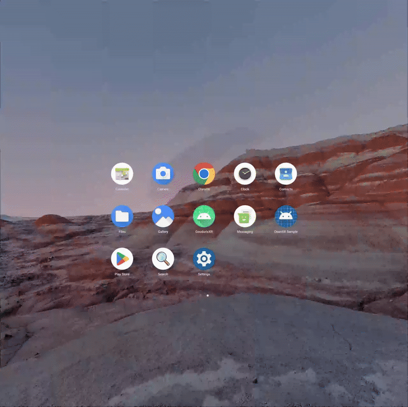

# GoudurixXR: Immersive Video Player Demo

This project is a demonstration of immersive video playback in an Android XR environment. It showcases the use of *
*Jetpack Media3 (ExoPlayer)** for robust video handling and **Sceneform (GLTF)** for rendering 3D models within the
scene.

The primary goal is to provide a reference implementation for creating media-rich XR applications and try out API
performance.

---

## 🎥 Demo

The following videos demonstrate the playback functionality on both a standard Android device and an Android XR
emulator.

|             XR Emulator              |               Phone               |
|:------------------------------------:|:---------------------------------:|
|  |  |

---

## ✨ Features

* **ExoPlayer Integration:** Utilizes the powerful `androidx.media3` library for efficient video playback.
* **XR Spatial UI:** Leverages `androidx.xr.compose` to create a user interface that exists in 3D space.
* **GLTF Model Rendering:** Demonstrates how to load and display a `.gltf` 3D model (a football field) within the XR
  scene.
* **Adaptive UI:** The UI adapts between standard "flat" screen mode and immersive XR mode.
* **Clean Architecture:** Follows modern Android best practices using Hilt for dependency injection, Kotlin Coroutines,
  and a ViewModel-driven UI layer.

---

## 🎬 Video Sources

This sample is configured to play videos from two types of sources:

1. **Remote HLS Stream:** A high-quality adaptive stream hosted at  
   [https://hls-video-samples.r2.immersiv.cloud/](https://hls-video-samples.r2.immersiv.cloud/)
2. **Local Curated Samples:** Lower bitrate videos included for performance testing and compatibility.

> ⚠️ Note: Some Android XR emulators may struggle with high-bitrate streams. Use the local samples for reliable playback
> in emulated environments.

---

## 🚀 Getting Started

1. Clone this repository.
2. Build and run the app using Android Studio Otter (See #🛠️ Build Environment).

---

## 🛠️ Build Environment

- **IDE:** Android Studio Otter \| 2025.2.1 Canary 4
- **Build \#:** AI-252.25557.131.2521.14204915 (October 2, 2025)
- **Runtime:** 21.0.8\+-14196175-b1038.72 aarch64
- **VM:** OpenJDK 64-Bit Server VM by JetBrains s.r.o.
- **Toolkit:** sun.lwawt.macosx.LWCToolkit
- **OS:** macOS 26.0.1
- **GC:** G1 Young Generation, G1 Concurrent GC, G1 Old Generation
- **Memory:** 8192M
- **Cores:** 12
- **Metal Rendering:** ON

## 🙏 Acknowledgements

- [Jetpack Media3](https://developer.android.com/jetpack/androidx/releases/media3)
- [Sceneform](https://github.com/Sceneform/sceneform-android)
- [Android XR Compose](https://developer.android.com/jetpack/compose/graphics/xr)